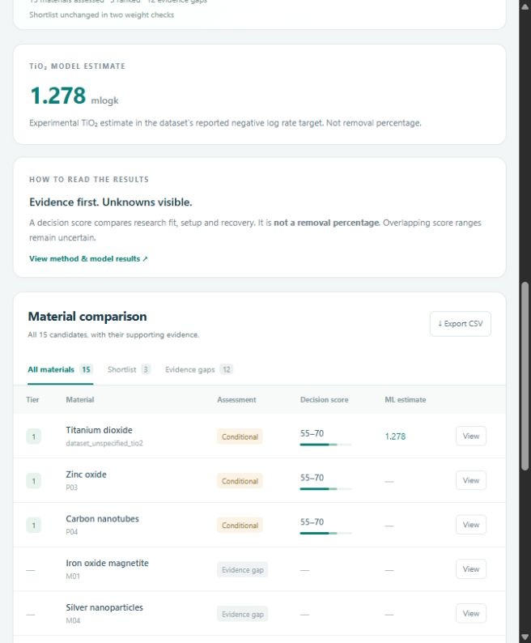

# NanoSelect

A local research prototype for choosing nanomaterial candidates for water remediation. The browser interface compares **15 material families**, explains its evidence and uncertainty, and adds a trained **TiO2 Random Forest predictor** where the inputs are supported.



## Run locally

Use Python **3.10** and the pinned dependencies to load the included model with its original library versions. From the repository folder in PowerShell:

```powershell
py -3.10 -m venv nanomaterial_hybrid/.venv
& ./nanomaterial_hybrid/.venv/Scripts/python.exe -m pip install -r ./nanomaterial_hybrid/requirements-lock.txt
./run.bat
```

If `py` is unavailable, use the path to your Python 3.10 executable for the first command. Setup requires internet; the demo then works locally without retraining or downloading research data. Keep the terminal open while using the page, normally at http://127.0.0.1:8765/. Press Ctrl+C to stop it.

On Linux or macOS:

```bash
python3.10 -m venv nanomaterial_hybrid/.venv
nanomaterial_hybrid/.venv/bin/python -m pip install -r nanomaterial_hybrid/requirements-lock.txt
cd nanomaterial_hybrid
.venv/bin/python -m src.webapp
```

## What it does

- Accepts pollutant, concentration, pH, catalyst dose, temperature, treatment time, illumination and equipment assumptions.
- Screens all 15 families using curated source evidence and deterministic suitability, setup and recovery rules.
- Shows score intervals and overlapping shortlists instead of inventing a unique winner when evidence is insufficient.
- Provides an eligible TiO2 numerical estimate separately from the ranking, plus explanations, citations and CSV export.
- Includes examples for sulfamethoxazole under UV, sulfamethoxazole without light, dissolved Pb(II), and an unsupported pollutant.

The catalogue includes Fe3O4, TiO2, ZnO, Ag, nZVI, GO, rGO, CNTs, Al2O3, MgO, MnO2, CeO2, nano-hydroxyapatite, montmorillonite and chitosan nanoparticles.

## Model and research limits

The literature catalogue contains 19 observations from 14 papers, covering 13 of 45 family/pollutant pairs for three pollutants. The lead nZVI observation applies to a specific shell-supported composite; the new SMX nZVI and graphene oxide profiles are based on abstracts with incomplete conditions. Missing evidence does not mean a material fails. Numerical ML predictions are available only for supported TiO2 inputs; the other families use evidence rules.

The webpage supports side-by-side comparison, adjustable decision priorities, an HTML report that can be printed as PDF, and a reference table of the user-provided material properties. The supplied property ranges and uses are unverified background, not evidence used to fill gaps or rank unsupported materials.

The regression used 440 audited records with 350 training and 90 test rows, grouping identical input conditions to avoid direct overlap. Held-out MAE is **0.1459**, RMSE **0.2128**, and R squared **0.8731** in the reported `mlogk` target. These values are not percentage accuracy. Study-independent validation was unavailable because source study identifiers were absent.

Decision scores are not pollutant removal percentages. The target's logarithm base remains unverified, so the application does not convert predictions to physical rates or removal percentages. This is a research demonstration, not a validated drinking-water treatment recommendation.

## Project contents

| Location | Contents |
| --- | --- |
| `run.bat` | Windows webpage launcher |
| `nanomaterial_hybrid/web/` | Local browser interface |
| `nanomaterial_hybrid/src/` | Acquisition, audit, training, inference, ranking and HTTP server |
| `nanomaterial_hybrid/models/` | Trained model, hash, model card and input-domain metadata |
| `nanomaterial_hybrid/data/` | Curated evidence, processed data and source manifest |
| `nanomaterial_hybrid/config/` | Model/ranking settings and demo scenarios |
| `nanomaterial_hybrid/tests/` | Scientific rules, inference and interface API checks |
| `nanomaterial_hybrid/notebooks/` | Supporting analysis notebooks |
| `nanomaterial_hybrid/outputs/` | Evaluation, source coverage, saved results and verification reports |
| `plan_qa/`, `build_plan.py` | Original planning document assets and generator |

## Verify or reproduce

Check that the shipped demo is ready:

```powershell
./run.bat --check
```

The full test suite also checks original downloaded source hashes. Restore those inputs first, then run the tests from the project subfolder:

```powershell
cd nanomaterial_hybrid
& ./.venv/Scripts/python.exe -m src.acquire
& ./.venv/Scripts/python.exe -m src.acquire_evidence
& ./.venv/Scripts/python.exe -m pytest -q
```

To reproduce training, run `-m src.data_audit` and then `-m src.train` with the same interpreter. Retraining is optional and replaces model artifacts; it is unnecessary for normal use. Read the [project documentation](nanomaterial_hybrid/README.md), [interface guide](nanomaterial_hybrid/START_HERE.md), and [presentation notes](nanomaterial_hybrid/PRESENTATION.md) for details.

## Data attribution

The TiO2 source dataset comes from [mahyavs/GNN_photodegradation](https://github.com/mahyavs/GNN_photodegradation), pinned to commit `c59e1a748b36b87eb051d9ce0acf6962bab1d118`. Sources, download hashes and literature links are recorded in `nanomaterial_hybrid/data/source_manifest.json` and `data/sources.csv`.

Downloaded original papers, spreadsheets and upstream code are excluded from this repository; acquisition scripts restore them. No upstream repository licence was located during the audit. Included derived data and model artifacts do not establish redistribution rights for the upstream materials; consult the recorded source terms before wider reuse. No blanket licence is assigned to third-party research content.
